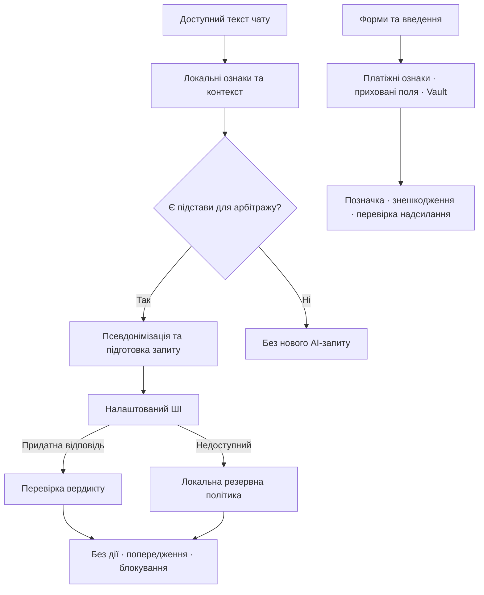

<div align="center">
  
  <h1>С.О.В.А.</h1>
  <p><strong>Система Оперативного Виявлення Аномалій</strong></p>
  <p>Помітити маніпуляцію. Зрозуміти ризик. Зупинитися до передачі даних.</p>
</div>

<p align="center">
  <a href="https://github.com/prylutskyy/S.O.V.A./actions/workflows/evaluation.yml"></a>
  <a href="https://prylutskyy.github.io/S.O.V.A./#combined"></a>
  <a href="https://prylutskyy.github.io/S.O.V.A./#combined"></a>
</p>

<p align="center">
  <a href="docs/USER_GUIDE.md"><strong>Посібник зі скріншотами</strong></a> ·
  <a href="https://prylutskyy.github.io/S.O.V.A./"><strong>Метрики та історія</strong></a> ·
  <a href="#запустити-розширення"><strong>Встановлення</strong></a> ·
  <a href="https://github.com/prylutskyy/S.O.V.A./issues"><strong>Долучитися</strong></a>
</p>

**С.О.В.А. — розширення для Chromium, яке допомагає помітити соціальну інженерію в чатах і ризик передачі чутливих даних у вебформах.** Воно поєднує локальні перевірки, контекст розмови, персональне сховище маркерів і додатковий арбітраж ШІ.

Співрозмовник просить «підтвердити отримання грошей», форма доставки потай запитує картку, анкета роботодавця збирає контрольні дані — у цих ситуаціях С.О.В.А. може пояснити ризик і втрутитися перед передаванням інформації.

> **Статус:** відкритий дослідницький прототип і дипломний проєкт із кібербезпеки. Скріншоти показують робочі сценарії; сумісність із кожним сайтом і виявлення всіх атак не гарантовані.

## Захист, який можна побачити й пояснити

| Можливість | Що отримує користувач |
| --- | --- |
| **Аналіз чатів** | Попередження про підозріле прохання з урахуванням контексту |
| **Захист платіжних даних** | Позначення чутливого введення й перевірка перед надсиланням |
| **Аудит прихованих полів** | Виявлення та локальне знешкодження пасток автозаповнення |
| **Personal Vault** | Розпізнавання збережених конфіденційних маркерів, можливість підставити приманку |
| **Пояснення XAI** | Причини рішення, сигнали форми, контексту та дії користувача |
| **Дебагер за бажанням** | Поточний стан, журнал подій, перевірки ШІ та семантичний спектр |

### Звичайний режим: без потоку технічних повідомлень

Дебагер за замовчуванням вимкнений. Для роботи захисту не потрібно відкривати логи, вектори чи промпти: локальні перевірки та налаштований ШІ працюють у фоні.

Якщо немає активного попередження, ви користуєтеся звичайним інтерфейсом сайту. Підозрілий запит може викликати банер; для критичних сценаріїв можливе блокування. Додаткові деталі розгортаються за потреби. Під час ШІ-перевірки індикатор очікування з’являється лише після однієї секунди. У полях із чутливим призначенням можуть бути невеликі позначки захисту навіть без дебагера.

Відсутність банера не доводить безпеку, а внутрішній бал ризику не є ймовірністю шахрайства.

### 1. Чат: прохання перейти за посиланням «для отримання коштів»

[](docs/screenshots/user-guide/chat-delivery-warning.png)

На демонстраційному маркетплейсі співрозмовник стверджує, що вже оплатив товар, і просить перейти за зовнішнім посиланням. Банер називає ризик; у розгорнутому вигляді можна прочитати пояснення та фрагмент репліки. Попередження не тотожне блокуванню всього чату.

**«Зрозуміло»** у звичайному некритичному попередженні підтверджує ознайомлення й скидає відповідний активний стан. **«Закрити»** приховує банер без скидання рівня загрози. Нові докази можуть знову активувати захист.

[Банер і його пояснення →](docs/USER_GUIDE.md#попередження-в-чаті)

#### Коли блокується сам ввід

[](docs/screenshots/chat-protection-2026-10-11.jpg)

На цьому знімку з otr.to запит повної seed-фрази викликав **LOCK_INPUT**: поле перекрите повідомленням «Дію відхилено · Ввід заблоковано С.О.В.А.». Це блокування інтерфейсу вводу, а не модальне підтвердження одного надсилання CVV. Поточний механізм також перехоплює введення, вставлення й натискання кнопок сторінки; його дія може виходити за межі одного поля чату.

**Потенційне вербування або диверсія** має окремий критичний сценарій: банер «Ознаки ворожого вербування або диверсії», блокування вводу та кнопка «єВорог». Згадки військової тематики чи схожості у «Спектрі» недостатньо для локального блокування. ШІ-рішення потребує відомого критичного типу та впевненості від 75; локальний резерв додатково перевіряє конкретне небезпечне прохання. Кнопка переходу до бота не надсилає повідомлення автоматично.

[](docs/screenshots/user-guide/chat-recruitment-lock.png)

На кадрі співрозмовник пропонує винагороду за диверсію або передавання військових координат. Розширення показує загрозу вербування й перекриває ввід; дебагер не відкрито. [Розгорнуте попередження](docs/screenshots/user-guide/chat-recruitment-details.png) пояснює ризик. На цьому кадрі «Перехоплений фрагмент» містить текст відмови замість видимої небезпечної пропозиції — це розбіжність показаного фрагмента, зазначена в посібнику.

[Блокування вводу, кнопки та сценарій вербування →](docs/USER_GUIDE.md#блокування-вводу-та-потенційне-вербування)

### 2. Секретний код: перевірка перед надсиланням

<p align="center">
  <a href="docs/screenshots/user-guide/chat-send-modal.png"></a>
</p>

Локальний захист введення може помітити CVV у полі чату. Під час спроби надіслати його відкривається модальне вікно: очікувана дія користувача зіставляється з виявленим ризиком. Основна дія — скасувати надсилання; у підтриманих сценаріях є усвідомлене продовження з утриманням кнопки. Це інший механізм, ніж критичне блокування вводу за типом загрози.

[Позначка CVV, модальне вікно та XAI →](docs/USER_GUIDE.md#перевірка-перед-надсиланням-cvv)

### 3. Прихована пастка: форма просить ім’я, але готує реквізити картки

[](docs/screenshots/hidden-fields-highlighted-2026-10-11.png)

У демосценарії доставки поряд із видимими полями телефону та ПІБ сховані номер картки, термін дії й CVV/CVC. С.О.В.А. повідомляє про три захищені поля та дозволяє підсвітити їхні позиції. Знешкодження працює **локально, без відповіді Groq**; завершення чотирисекундного підсвічування не відновлює поля.

[Як знешкоджуються поля й що означають кнопки →](docs/USER_GUIDE.md#приховані-поля-та-автозаповнення)

### 4. Personal Vault: помітити саме ваш конфіденційний маркер

| Сховище | Перевірка перед відправленням форми |
| :---: | :---: |
| [](docs/screenshots/user-guide/vault-unlocked.png) | [](docs/screenshots/user-guide/form-submit-modal.png) |

У сховищі налаштовуються контрольні значення: наприклад, податковий номер, кодове слово чи номер документа. Система розділяє підказку «поле запитує чутливі дані» та збіг із конкретним збереженим значенням. За підтвердженого збігу форма може бути призупинена; якщо доступна приманка, користувач може підставити її у відповідні поля.

Дія підстановки також дозволяє продовження перехопленої відправки; інші поля не обов’язково змінюються. Для повного скасування оберіть повернення до безпечного стану.

На знімку **«3 із 7 / 43%» — частка налаштованих категорій сховища**, а не точність чи рівень безпеки. Locked Vault і розблокований режим мають різні можливості; частина фонового розпізнавання за вже створеними сигнатурами може працювати й після блокування сховища. Перевірки мають винятки для довірених доменів: зелена позначка Vault у меню не гарантує перевірку кожного поля на такому сайті.

[Налаштування Vault, збіг із маркером, підміна й XAI →](docs/USER_GUIDE.md#personal-vault)

### 5. Прозорість: відкрийте дебагер, коли потрібні подробиці

<p align="center">
  <a href="docs/screenshots/user-guide/debugger-ai.png"></a>
</p>

Шлях: **меню розширення → Settings / «Опції» → Debugger / «Дебагер»**. Також доступна комбінація **Ctrl+Shift+D**. Увімкнення діагностики не потрібне для захисту.

| Вкладка | Що пояснює |
| --- | --- |
| **Огляд** | Поточну дію й причину активного стану |
| **Події** | Послідовність сигналів, фільтри, пошук і паузу перегляду |
| **ШІ** | Окрему перевірку: провайдера, модель, відповідь і контекст |
| **Спектр** | Подібність локальних ознак до еталонів; це не остаточний вердикт |

Режим **«Наживо»** оновлює перегляд автоматично. Пауза фіксує показані дані, а не вимикає захист. Висновок минулої ШІ-перевірки може відрізнятися від поточного стану — для дії зараз дивіться «Огляд».

**[Повний візуальний посібник: усі 30 наданих скріншотів, приховані поля та браузерні перевірки →](docs/USER_GUIDE.md)**

Скріншоти інтерфейсу датовані 11.10.2026 та збережені без редагування. Вони показують конкретні стани UI, а не результати нового benchmark. На частині кадрів англійський інтерфейс розширення й український демостенд; мова залежить від локалізації. [Походження зображень](docs/screenshots/user-guide/README.md) · [звіт про браузерний прохід](docs/UI_FUNCTIONAL_WALKTHROUGH.md) · [звірка описів із кодом](docs/UI_DESCRIPTION_AUDIT.md).

## Як працює аналіз



- **Контекст:** локальні докази збираються з вхідних повідомлень співрозмовника. Ваші відповіді допомагають ШІ зрозуміти розмову. Давні репліки втрачають вагу й вилучаються після 15 хвилин від моменту їх виявлення розширенням.
- **Намір:** правила оцінюють пов’язані ознаки та можливі класи; назва месенджера чи згадка паспорта сама по собі не повинна бути достатнім доказом атаки.
- **Компактний класифікатор:** навчена лінійна модель доповнює діагностику й за певних умов маршрутизацію. Вона може утриматися від прогнозу (`ABSTAIN`) і сама не блокує ввід. Це не генеративна LLM.
- **ШІ-арбітр:** складний запит може передаватися на перевірку без готового локального типу. Перед хмарним зверненням розпізнані приватні значення замінюються стабільними маркерами. Непридатна відповідь або ліміт API не означають «безпечно».
- **Резерв:** за недоступності хмарного провайдера може використовуватися підтримуваний вбудований ШІ браузера, далі — локальна політика. Для локального жорсткого блокування потрібні конкретні докази; AI-криптоблокування перевіряється на сумісність із контекстом гаманця.
- **Перехід між сторінками:** у підтриманих сценаріях ризик чату може впливати на наступну вкладку, відкриту з нього. Це обмежене перенесення контексту, не відстеження всіх ваших переходів.

Детально: [специфікація](docs/PROJECT_IMPLEMENTATION_SPECIFICATION.md) · [політика маршрутизації](src/heuristics/ai-routing-policy.ts) · [перевірка форм](src/heuristics/hidden-field-inspector.ts) · [Vault](src/core/personal-vault.ts).

## Наскільки добре це працює

Якість вимірюємо окремо від працездатності коду. Зелені автоматизовані перевірки означають, що виконані їхні умови; вони **не означають 100% виявлення атак**.

### Чотири блоки локального оцінювання

| Блок | Що перевіряємо | Обсяг | F1 | Recall |
| --- | --- | --- | --- | --- |
| **1 · Регресії** | Відомі загрози, безпечні репліки та виправлені помилки; правила вже налаштовували за цими даними | 326 сценаріїв | [](https://prylutskyy.github.io/S.O.V.A./#regression) | [](https://prylutskyy.github.io/S.O.V.A./#regression) |
| **2 · Нові діалоги** | Поступове входження в довіру, фальшиві керівники, знайомі, підтримка та редакції | 300: 200 визначених + 100 неоднозначних | [](https://prylutskyy.github.io/S.O.V.A./#challenge) | [](https://prylutskyy.github.io/S.O.V.A./#challenge) |
| **3 · Сліпий A** | Контекстні діалоги з попереднім консенсусом двох ШІ-рецензій | 300: 244 у binary-оцінці, 239 у точному збігу | [](https://prylutskyy.github.io/S.O.V.A./#review-stress) | [](https://prylutskyy.github.io/S.O.V.A./#review-stress) |
| **4 · Сліпий B** | Змішані мови, Unicode, розбиті запити та цитати; перетворення 60 кейсів A | 300: 240 у binary-оцінці | [](https://prylutskyy.github.io/S.O.V.A./#review-stress) | [](https://prylutskyy.github.io/S.O.V.A./#review-stress) |

**Як читати цифри:** precision — частка розмічених загроз серед спрацьовувань; recall — частка розмічених загроз, які виявлено; F1 поєднує ці дві метрики. Правильність конкретного типу та дії перевіряє окремий «точний збіг». Хибні блокування також рахуються окремо.

Зведені бейджі зверху використовують сумарні TP/FP/FN/TN **526 визначених прикладів перших двох блоків**, а не середнє F1 і не всі чотири блоки. Навіть 100% на відомих регресіях означає відповідність знайомим прикладам. Синтетичні сімейства споріднені; розмітка нових блоків потребує незалежного аудиту. A/B показані окремо, без ручного узгодження двох ШІ-рецензій. Неоднозначні й спірні мітки мають окремі знаменники.

### Локальний резерв + Groq

Зафіксований діагностичний прогін **28 діалогів: 24 визначені та 4 неоднозначні/спірні**:

| Режим | Precision | Recall | F1 | Хибні спрацьовування |
| --- | ---: | ---: | ---: | ---: |
| Локальний резерв | 80,0% | 75,0% | 77,4% | 3 |
| Локальна маршрутизація + Groq | 100,0% | 75,0% | 85,7% | 0 |

Чотири загрози не дійшли до ШІ через пропуски маршрутизації. У live-прогоні було одне надмірне блокування через неправильний AI-тип; після контекстного обмеження криптоблокування replay тих самих відповідей дав нуль таких помилок. **Replay виконувався без нових API-запитів** і не є незалежним повторним вимірюванням. Ці цифри не замінюють метрики повних корпусів і не доводять точність у реальному світі.

[Звіт local + Groq](tests/review/ROUTING_EVALUATION_REPORT.md) · [перший стрес-прогін A/B](tests/review/LOCAL_EVALUATION_REPORT.md) · [перевірка анонімізації через Groq](tests/results/GROQ_PRIVACY_SMOKE_REPORT.md).

**Історія прогресу:** [dashboard](https://prylutskyy.github.io/S.O.V.A./) показує результати блоків та історію вимірювань; [CHANGELOG](CHANGELOG.md) пояснює зміни алгоритму. CI оцінює локальні корпуси на push і pull request, а Pages оновлюється з `main`. Живі виклики Groq запускаються окремо, вручну.

## Конфіденційність

Локальні евристики аналізують оригінальні повідомлення на пристрої. **За ввімкненого хмарного ШІ підготовлений контекст передається зовнішньому провайдеру.**

Перед відправленням система приховує розпізнані секрети, контакти, контекстні імена, адреси та ідентифікатори. Однакове значення отримує однаковий маркер у межах сесії — наприклад, `[PERSON_1]` або `[EMAIL_1]`. Ролі, прохання й мета залишаються для аналізу. Помилка підготовки не дозволяє відправити оригінальний текст.

Це **не повна анонімізація довільного тексту**: нестандартні адреси, невідомі імена, непрямі ідентифікатори та приватні значення в доменах можуть залишитися. Перевіряйте діагностичні експорти перед публікацією; для демонстрацій використовуйте вигадані дані.

[Пайплайн приватності, приклади та обмеження](docs/PRIVACY_PIPELINE.md).

## Запустити розширення

Потрібні **Node.js 22.12+**, npm і браузер на основі Chromium. Поточний спосіб встановлення — локальна збірка.

```bash
git clone https://github.com/prylutskyy/S.O.V.A..git
cd S.O.V.A.
npm ci
npx wxt prepare
npm run build
```

1. Відкрийте `chrome://extensions/` та увімкніть **режим розробника**.
2. Натисніть **«Завантажити розпаковане розширення»** й виберіть `.output/chrome-mv3`.
3. Відкрийте меню С.О.В.А., перевірте стан захисту та налаштування модулів.
4. За бажанням налаштуйте Groq або іншого підтриманого провайдера у вкладці опцій. API-ключ не потрібен для локальних правил. Вбудований ШІ браузера доступний лише там, де підтримується.
5. Для першої перевірки відкрийте [локальний демостенд](docs/demo/index.html). Використовуйте синтетичні дані. Після оновлення збірки перезавантажте розширення та тестову сторінку.

Для розробки з автоматичною перебудовою: `npm run dev`. Завантажуйте розширення з каталогу, який виведе WXT.

### Команди розробника

| Команда | Призначення |
| --- | --- |
| `npm run compile` | Перевірка TypeScript після підготовки WXT |
| `npm test -- --exclude 'tests/integration/**'` | Автоматизовані перевірки без живих інтеграцій |
| `npm run test:corpus` | Локальне оцінювання регресій і challenge-корпусу |
| `npm test -- tests/review/detector.evaluation.test.ts` | Оцінювання сліпих блоків A/B |
| `npm run build` | Production-збірка розширення |
| `npm run zip` | Архів для розповсюдження збірки |

Живі інтеграції потребують явного ввімкнення й API-ключа; вони витрачають квоту. [Інструкції та обмеження Groq-тестів](tests/integration/README.md). Не додавайте ключі до коду, корпусів чи комітів.

## Що ще потребує перевірки

- **Сумісність чатів.** Напрямок реплік визначається за DOM; нестандартний інтерфейс, закритий Shadow DOM або недоступний iframe можуть завадити аналізу.
- **Складна маніпуляція.** Розтягнута в часі соціальна інженерія, сарказм і нові схеми можуть пройти повз локальні сигнали та ШІ-маршрутизацію.
- **Рішення моделі.** ШІ може помилитися в типі чи висновку; валідний JSON не робить відповідь правильною.
- **Ресурси.** Ціль до 500 МБ пам’яті всього розширення та до 500 мс локального рішення на слабкому CPU ще потребує браузерного вимірювання. Benchmark окремої моделі не підтверджує ці межі для всього застосунку.

Проєкт допомагає оцінити ризик, але не замінює захист платформи, перевірку адреси сайту та обережність при передачі секретів.

## Долучайтеся до розробки

Найкорисніший внесок — **відтворювана проблема з прикладом**. Нам потрібні безпечні діалоги, що спричиняють тривогу, пропущені підозрілі запити, перевірки сумісності сайтів і вдосконалення інтерфейсу.

1. Створіть [Issue](https://github.com/prylutskyy/S.O.V.A./issues): браузер, кроки, очікувана й фактична поведінка, синтетичний приклад. Приберіть приватні дані зі скріншотів та логів.
2. Для зміни алгоритму додайте регресійний тест і безпечний контрприклад. Не підганяйте правила під оцінювальні блоки; документуйте походження нових даних.
3. Запустіть перевірку TypeScript і відповідні тести; для евристик — також оцінювання корпусів.
4. Надішліть невеликий [pull request](https://github.com/prylutskyy/S.O.V.A./compare): проблема, рішення, результати перевірок і компроміси.

Можна допомогти й без коду: [перевірити розмітку діалогів](tests/review/README.md), запропонувати сценарій або описати незрозумілу поведінку UI.

### Навігація проєктом

| Потрібно розібратися в… | Відкрити |
| --- | --- |
| Користуванні розширенням і всіх прикладах інтерфейсу | [Візуальний посібник](docs/USER_GUIDE.md) |
| Що безпосередньо перевіряли в браузері | [Функціональний прохід](docs/UI_FUNCTIONAL_WALKTHROUGH.md) |
| Алгоритмі, життєвому циклі загрози й обмеженнях | [Специфікація роботи](docs/PROJECT_IMPLEMENTATION_SPECIFICATION.md) |
| Підготовці даних для зовнішнього ШІ | [Приватність](docs/PRIVACY_PIPELINE.md) |
| Структурі коду | [Посібник розробника](docs/DEVELOPMENT_GUIDE.md) |
| Спільній мові інтерфейсу | [Дизайн-система](docs/DESIGN_SYSTEM.md) |
| Форматі тестових кейсів | [Корпус та методика](tests/evaluation/README.md) |
| Навченому компактному класифікаторі | [Навчання й оцінювання](training/local-intent/README.md) |
| Що змінилося й навіщо | [Журнал змін](CHANGELOG.md) |
