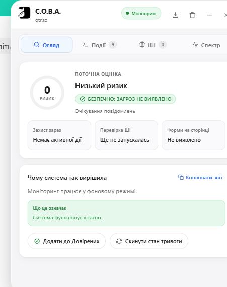
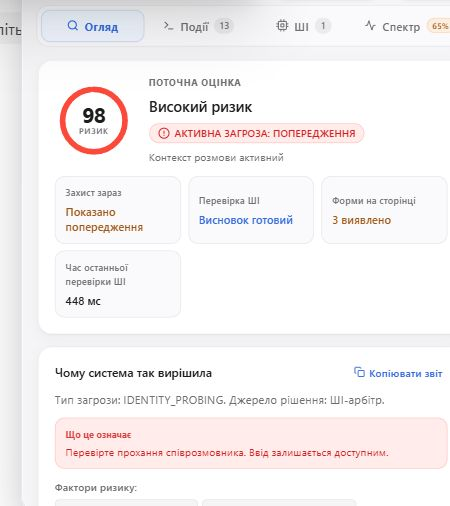
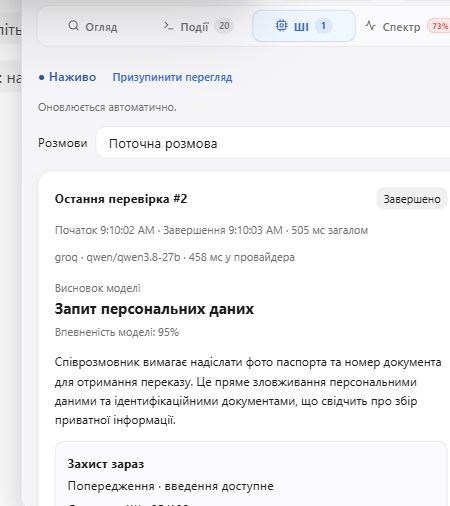
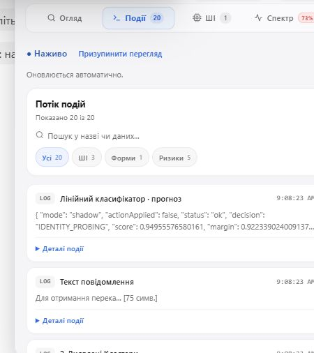
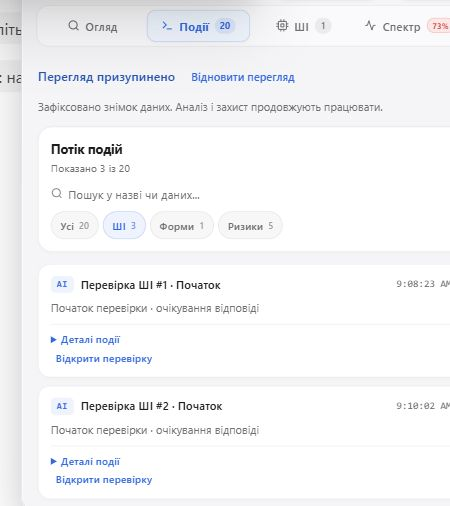
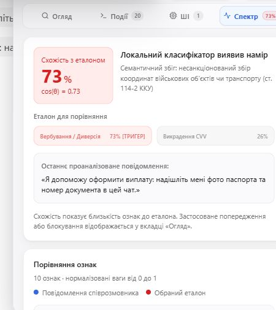

# С.О.В.А. у браузері: від тихого захисту до пояснення рішення

[Візуальний посібник із галереєю скріншотів](USER_GUIDE.md) доповнює цей звіт описом Vault, CVV, модальних вікон, XAI й підміни маркерів. Нижче збережено джерела та межі саме цього браузерного проходу.

**Дата:** 11.10.2026. Це огляд інтерфейсу й конкретних спостережуваних станів, а не нове вимірювання точності алгоритму.

Чат перевірено на otr.to між двома власними вкладками. Використано лише синтетичні репліки, без реальних документів чи секретів. Перед перевірками користувач повідомив про перебудову розширення, перезавантаження та ввімкнений Groq. Для прихованих полів використано два скріншоти локальної тестової сторінки у Brave. Джерела доказів нижче розділені.

## 1. Звичайне користування: панель не потрібна

Після репліки «Вітаю! Чи ще доступна книжка? Можу забрати завтра біля бібліотеки» у спостережуваному чаті не було захисного банера чи діагностичної панелі. Поле введення залишалося доступним.


Розширення не має підтверджувати безпечність кожної репліки повідомленням. Відсутність втручання означає відсутність показаної захисної дії, а не гарантію безпеки. За тривалого арбітражу можливий індикатор очікування після однієї секунди.

## 2. Попередження й блокування — різні дії

| Вхідний запит | Що спостерігали |
| --- | --- |
| Серія та номер паспорта для переказу | Банер «Випитування особистих даних», поле введення доступне |
| Усі 12 слів seed/recovery phrase для відновлення криптогаманця | Банер про спробу викрадення криптогаманця та захисне перекриття введення |

[Попередження без дебагера](screenshots/chat-warning-2026-10-11.jpg) · [блокування без дебагера](screenshots/chat-protection-2026-10-11.jpg).


Кадр показує криптосценарій. Сценарій потенційного вербування має окремий банер і набір кнопок; [його опис за поточним кодом](USER_GUIDE.md#блокування-вводу-та-потенційне-вербування) не видається за спостереження у цьому проході. [Звірка описів](UI_DESCRIPTION_AUDIT.md) також уточнює область блокування й поведінку критичних кнопок.

У документацію додано [три кадри демосценарію вербування](USER_GUIDE.md#окремий-сценарій-потенційного-вербування): банер із «єВорог», перекриття вводу, відхилену дію й розгорнуте пояснення. Їх додано до посібника як окреме джерело, без повторного браузерного проходу. У розгорнутому кадрі зафіксовано невідповідність показаного фрагмента видимій репліці.

Цей короткий прохід показує стани інтерфейсу. Він не є повним тестом усіх способів надсилання, не вимірює частоту помилок і не підтверджує універсальну підтримку DOM різних платформ.

## 3. Дебагер відкривається за бажанням

Шлях: меню розширення → «Опції» → «Дебагер». Штатна комбінація Ctrl+Shift+D також перемикає режим. Під час знімків її використано для ввімкнення панелі, а після завершення — для повернення вимкненого стану.



Цей кадр зроблено після натискання «Скинути стан тривоги» у тестовій сесії. Видно відсутність активної дії та очікування повідомлень. Це демонстрація скидання стану, а не новий висновок про безпечність попереднього запиту. Скидання також очистило історію ШІ-перевірок поточної сесії в інтерфейсі.

### «Огляд»: що система робить зараз



У кадрі видно поточний ризик, дію «Показано попередження», завершену ШІ-перевірку та тип IDENTITY_PROBING. Джерело рішення — ШІ-арбітр. Пояснення окремо вказує, що введення залишається доступним.

Число ризику не є відкаліброваною ймовірністю шахрайства. Лічильник «Форми на сторінці» також не означає кількість виявлених пасток.

### «ШІ»: що відповіла конкретна перевірка

Після скидання стану надіслано нову синтетичну репліку: «Я допоможу оформити виплату: надішліть мені фото паспорта та номер документа в цей чат».



На вкладці видно завершену перевірку #2, провайдера groq, модель qwen/qwen3.8-27b, висновок «Запит персональних даних» і пояснення моделі. На конкретному кадрі — 505 мс загалом та 458 мс у провайдера. Це дані одного запису, а не benchmark швидкодії.

Висновок моделі й «Захист зараз» — різні частини інтерфейсу. Історичний запис не повинен сприйматися як незмінний поточний стан. [Повна сторінка з відкритою панеллю](screenshots/debugger-ai-on-page-2026-10-11.jpg).

### «Події»: фільтрація та пауза



Журнал показав 20 подій. Після вибору фільтра «ШІ» — 3 з 20. Кнопка «Призупинити перегляд» змінила стан на «Перегляд призупинено» з дією відновлення.



Підпис пояснює: «Зафіксовано знімок даних. Аналіз і захист продовжують працювати». Після знімка перегляд відновлено. У цьому проході перевірено перемикання стану UI, а окремий експеримент із новою атакою під час паузи не проводився.

### «Спектр»: допоміжний сигнал, не остаточний вердикт



Кадр показує схожість 73% із вибраним еталоном і текст останньої репліки. Важлива межа: для паспортного запиту найближчий показаний еталон — військова тематика, тоді як остаточний ШІ-тип у цьому ж діалозі — IDENTITY_PROBING і дія WARN.

Цю розбіжність не приховано: семантична близькість може бути нецільовою. Вона не доводить військової загрози й не повинна подаватися як остаточна класифікація. Для фактичної дії дивіться «Огляд». Подальша перевірка відповідності еталонів і зрозумілості цього повідомлення є доречним завданням для алгоритму та UX.

## 4. Приховані поля: виявлення та знешкодження

Тестовий сценарій: [delivery-scam.html](demo/scenarios/delivery-scam.html). Видима форма запитує телефон і ПІБ під приводом доставки. У контейнері `.visually-hidden` містяться три додаткові поля:

| Поле | Підказка браузеру для автозаповнення |
| --- | --- |
| card_number | cc-number |
| card_exp | cc-exp |
| card_cvv | cc-csc |

Контейнер має розміри 1×1 піксель, обрізання й приховування переповнення. Таким способом сторінка може готувати збір реквізитів, яких користувач не бачить серед звичайних полів.

### Що видно на наданих знімках


На скріншоті з Brave видно «Form neutralized», «Protected · 3 fields» та технічний аналіз пастки. Мова панелі англійська; сама демонстраційна сторінка українська.


Після «Highlight on form» видно три мітки CARD, MM/YY і CVV/CVC. Це тимчасова візуалізація позицій прихованих полів, а не перетворення їх на дозволені поля вводу. Інтерфейс указує тривалість підсвічування чотири секунди.

### Що означає знешкодження за кодом

[`disarmForm`](../src/heuristics/hidden-field-inspector.ts#L508) зберігає попередні атрибути та для визначених підозрілих полів установлює:

```text
disabled = true
autocomplete = "off"
tabIndex = -1
data-threat-shield-disarmed = "true"
```

Сканер виконує цю дію перед повідомленням про пастку. Це локальний механізм і він не чекає на відповідь Groq. Звичайні технічні hidden-поля, наприклад CSRF-токени, мають винятки: саме приховування поля не є достатнім доказом пастки.

- **«Підсвітити на формі»** показує позиції полів на чотири секунди; блокування не скасовується після завершення підсвічування.
- **«Окей» / «Закрити»** прибирають панель. За цим шляхом `restoreForm` не викликається.
- **«Довіряти цьому сайту»** викликає відновлення полів і для наявного hostname додає домен до винятків. Для локального file:// доменного hostname немає; відновлення полів однаково може виконатися.

Пов’язані реалізації: [сканер та disarm](../src/heuristics/hidden-field-inspector.ts) · [банер і підсвічування](../src/ui/friction.ts) · [існуючі тести інспектора](../tests/hidden-field-inspector.test.ts) · [існуючі тести банера](../tests/unit/ui/hidden-field-banner.test.ts).

### Межі підтвердження

Скріншоти показують локальну сторінку у Brave. Браузерне середовище огляду не відкривало file://, тому runtime-атрибути полів і мережевий трафік цієї сторінки тут не зчитувалися. Скриншоти підтверджують показаний інтерфейс; атрибути знешкодження описані за реалізацією.

Фраза банера «no real data was sent» не є доказом відсутності мережевого передавання. Знешкодження обмежує конкретні поля форми, але не ізолює всі скрипти сторінки й не гарантує відсутності інших каналів витоку.

Для окремої технічної перевірки без реальних даних: огляньте три поля у DevTools, перевірте наведені атрибути після спрацювання й події Network. Не натискайте «Довіряти» лише для отримання гарнішого скріншота.

## Підсумок проходу

Два моменти для наступного вдосконалення: у поточному вузькому вікні захисний банер частково накриває шапку дебагера; семантичний спектр може показувати нецільовий еталон, який легко сплутати з фінальним типом. Ці спостереження не виправлялися редагуванням скріншотів або зміною алгоритму в цій задачі.

| Функція | Джерело підтвердження |
| --- | --- |
| Тихий чат без дебагера | Безпосереднє браузерне спостереження агента |
| Попередження та критичне перекриття введення | Безпосереднє браузерне спостереження агента; не повний тест усіх подій введення |
| Огляд, ШІ, Події, Спектр | Безпосереднє відкриття вкладок і нові скріншоти |
| Фільтр ШІ, пауза та відновлення перегляду | Безпосереднє перемикання елементів UI |
| Скидання тривоги | Безпосереднє натискання та спостереження нового стану |
| Три приховані поля й їх підсвічування | Знімки інтерфейсу у Brave, огляд джерела демосценарію |
| disabled/autocomplete/tabIndex після disarm | Огляд реалізації; runtime-атрибути локальної сторінки не зчитувалися |

Нові автоматизовані тести чи повний повторний прогін корпусів у межах цього огляду не виконувалися. Попередні метрики залишаються окремими результатами. Після браузерного проходу агент вимкнув дебагер і закрив власні тестові вкладки.
