# Візуальний посібник С.О.В.А.

[← Головна сторінка проєкту](../README.md) · [Специфікація алгоритму](PROJECT_IMPLEMENTATION_SPECIFICATION.md) · [Функціональний прохід](UI_FUNCTIONAL_WALKTHROUGH.md)

Цей посібник пояснює роботу розширення через конкретні стани інтерфейсу: від головного меню до зупинки надсилання секрету й блокування потенційного вербування. Тут зібрано **всі 30 скріншотів, від 11.10.2026**, два знімки прихованих полів та окремі результати браузерного проходу на otr.to.

Знімки використано без редагування. Вони не є новим вимірюванням якості класифікації чи доказом відсутності передачі даних. Мова розширення залежить від локалізації браузера; на прикладах часто поєднуються англійські елементи С.О.В.А. й український демостенд. [Таблиця походження всіх 30 вкладень](screenshots/user-guide/README.md).

## Зміст

1. [Тихий режим](#тихий-режим)
2. [Головне меню й винятки для сайтів](#головне-меню)
3. [Personal Vault](#personal-vault)
4. [Налаштування ШІ та діагностики](#налаштування-ші-та-діагностики)
5. [Попередження в чаті](#попередження-в-чаті)
6. [Перевірка перед надсиланням CVV](#перевірка-перед-надсиланням-cvv)
7. [Захист персональних маркерів у формах](#захист-персональних-маркерів-у-формах)
8. [Приманка замість збереженого значення](#приманка-замість-збереженого-значення)
9. [Приховані поля та автозаповнення](#приховані-поля-та-автозаповнення)
10. [Контекст між сторінками](#контекст-між-сторінками)
11. [Вкладки дебагера](#вкладки-дебагера)
12. [Як читати числа й межі доказів](#як-читати-числа)

Окремо: [блокування вводу та потенційне вербування](#блокування-вводу-та-потенційне-вербування) · [звірка описів із реалізацією](UI_DESCRIPTION_AUDIT.md).

## Тихий режим

Розширення не вимагає постійно дивитися на технічну панель. Без дебагера чат виглядає звично, якщо немає активного попередження. Локальний аналіз та налаштований арбітр працюють незалежно від того, чи відкрито меню розширення.

[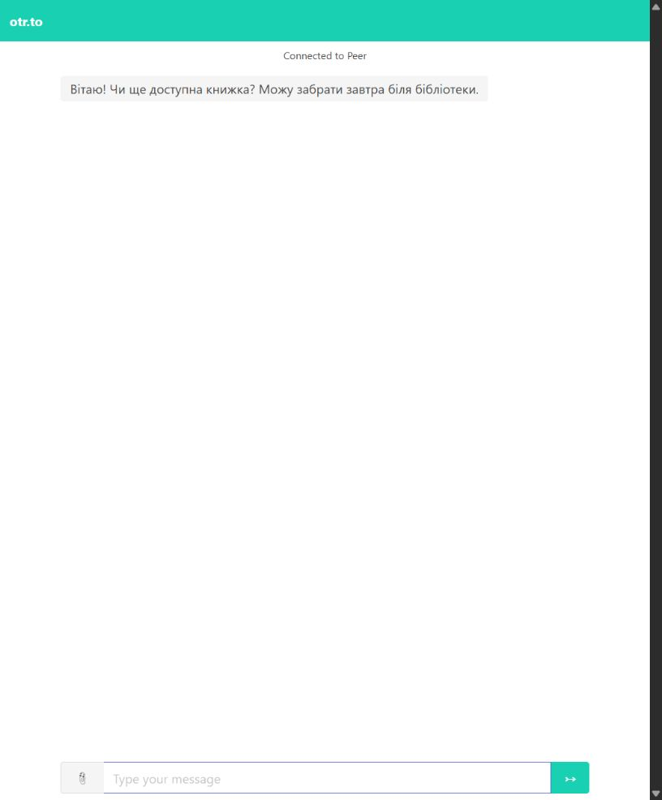](screenshots/chat-quiet-2026-10-11.jpg)

*Цей знімок показує окремий браузерний прохід між двома тестовими вкладками. На ньому немає попередження після звичайного запиту про книжку.*

У формах і полях чату можуть з’являтися невеликі позначки чутливих даних. Це частина звичайного захисту, а не ознака ввімкненого дебагера. Для перевірки ШІ, яка триває понад одну секунду, можливий індикатор очікування. Відсутність банера не є висновком про доведену безпеку.

## Головне меню

Натисніть іконку розширення. На вкладці **Shield / С.О.В.А.** видно поточний сайт, стан перевірок і модулі захисту.

<a href="screenshots/user-guide/popup-shield.png">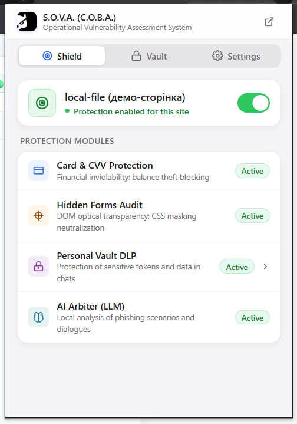</a>

| Модуль | Його роль |
| --- | --- |
| Card & CVV Protection | Платіжні ознаки та чутливі дані під час введення/надсилання |
| Hidden Forms Audit | Пастки прихованого автозаповнення й маскування полів |
| Personal Vault DLP | Зіставлення із налаштованими персональними маркерами |
| AI Arbiter | Додаткова перевірка підозрілого контексту |

Позначка **Active** — стан модуля в інтерфейсі. Вона сама по собі не підтверджує успішний API-виклик, наявність відповіді моделі чи виявлення атаки.

### Виняток для поточного сайту

<a href="screenshots/user-guide/popup-paused-site.png">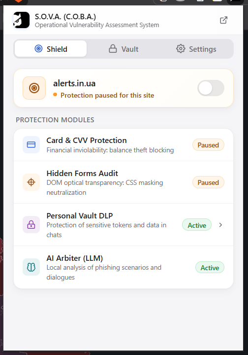</a>

На кадрі для alerts.in.ua показано **Protection paused**. Card & CVV Protection і Hidden Forms Audit показані призупиненими, але Vault та AI Arbiter мають окремі позначки. Це не універсальний перемикач усіх підсистем. Водночас зелений Vault не гарантує перевірку полів довіреного сайту: перехоплювач введення пропускає realtime-перевірку маркерів для доменів із імунітетом. При додаванні домену до винятків поточна сторінка також прибирає захисні банери, відновлює знешкоджені форми й знімає проактивні обмеження полів. Приклад домену показує налаштування користувача, а не підтверджену безпеку ресурсу.

У поточній реалізації перемикач пов’язаний зі списком довірених доменів. [Контролер меню](../entrypoints/popup/controllers/shield-tab.controller.ts).

## Personal Vault

Сховище допомагає розпізнати конкретні значення, які користувач хоче захистити, а не лише загальне призначення поля. Для демонстрацій налаштовуйте вигадані маркери.

### Заблоковане сховище

<a href="screenshots/user-guide/vault-locked.png">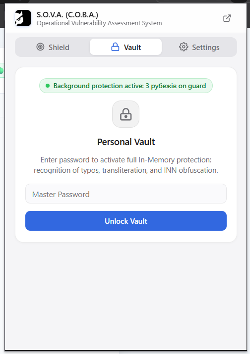</a>

Пароль відкриває повні можливості сховища. Напис про активний фоновий захист означає, що вже підготовлені сигнатури можуть використовуватися без відкритого редактора секретів. Locked не означає повної відсутності захисту; але його можливості не тотожні розблокованому режиму.

За реалізацією, оперативний набір заблокованого сховища не містить відкритих realValue, зберігаючи сигнатури, категорії й потрібні службові ознаки. Це не обіцянка, що дані ніколи не опиняються в пам’яті браузера під час роботи з ними. [Код сховища](../src/core/personal-vault.ts).

### Налаштовані категорії

<a href="screenshots/user-guide/vault-unlocked.png">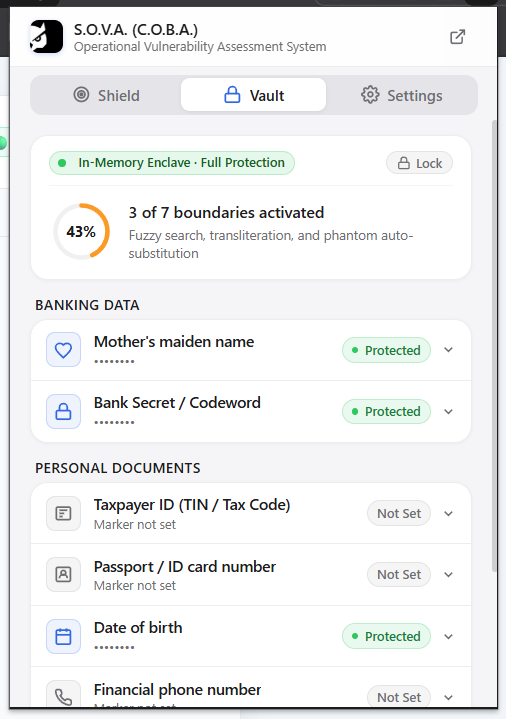</a>

Маркери згруповані за призначенням: банківські контрольні дані, документи й персональні відомості. **Protected** означає налаштовану активну категорію, **Not Set** — відсутність відповідного налаштованого значення.

**43% / 3 of 7** у цьому кадрі — частка налаштованих категорій. Це не ефективність детектора, не ймовірність захисту й не оцінка того, наскільки безпечний ваш браузер.

### Значення та його приманка

<a href="screenshots/user-guide/vault-marker-editor.png">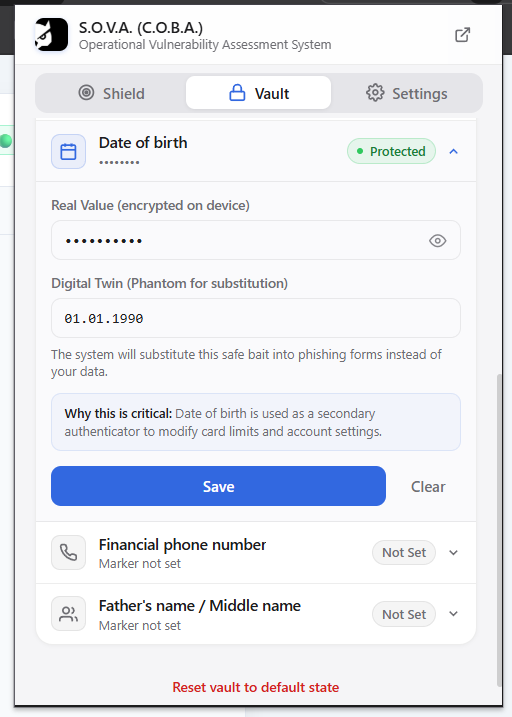</a>

У редакторі є **Real Value**, приховане в полі, і **Digital Twin / Phantom** — значення для підстановки. Приманка не повинна збігатися з вашим секретом. Save зберігає налаштування категорії, Clear очищує її. Кнопка Lock повертає сховище в заблокований стан.

Сховище використовує локальне шифрування та механізми зіставлення. Наявність шифрування не робить довільну сторінку безпечною й не заважає їй прочитати значення, яке ви вже ввели у її власне поле.

## Налаштування ШІ та діагностики

<a href="screenshots/user-guide/popup-settings.png">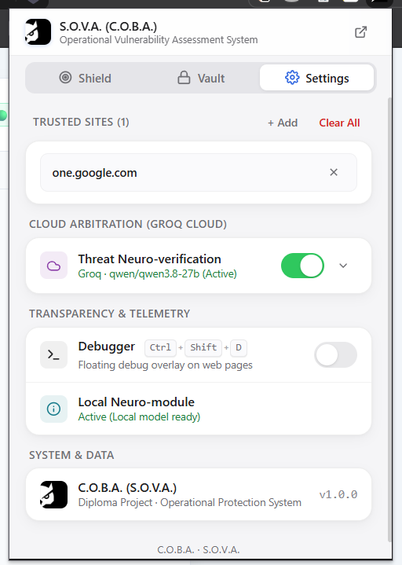</a>

На Settings / «Опції» розміщено список довірених сайтів, конфігурацію хмарного арбітражу та перемикач дебагера. На кадрі Groq увімкнений, а дебагер вимкнений — ці налаштування незалежні.

- **Groq** перевіряє підготовлений контекст за наявності ключа й доступної квоти. Поточна конфігурація може бути змінена користувачем.
- **Debugger** керує видимістю діагностичної панелі; комбінація Ctrl+Shift+D також перемикає її.
- **Local Neuro-module ready** показує стан локальної підсистеми, але не підтверджує, що браузер підтримує генеративний Gemini Nano або що конкретний запит перевіряла локальна LLM.
- **Trusted sites** — винятки користувача, а не автоматично перевірений каталог безпечних ресурсів.

Перед хмарною перевіркою розпізнані приватні значення псевдонімізуються. Це неповне розпізнавання всіх персональних даних. [Політика приватності](PRIVACY_PIPELINE.md).

## Попередження в чаті

У локальному демочаті обрано сценарій фальшивої доставки. Співрозмовник повідомляє про нібито оплату й просить підтвердити отримання коштів за стороннім посиланням.

[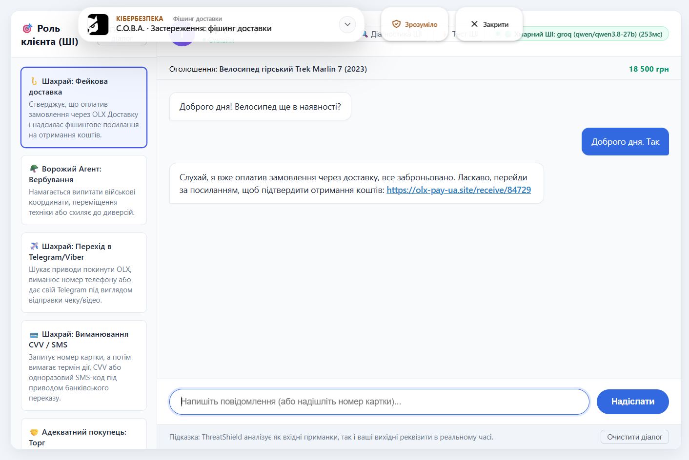](screenshots/user-guide/chat-delivery-warning.png)

Банер називає тип ризику. Звичайний текстовий ввід у цьому стані доступний. **WARN** не тотожне **LOCK_INPUT**; не кожне підозріле прохання має блокувати чат.

[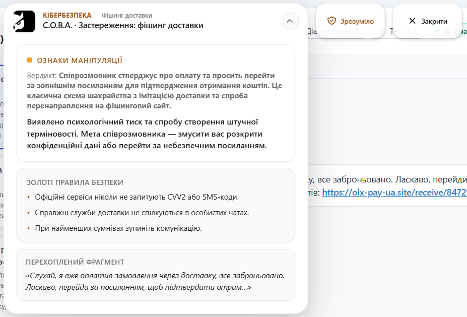](screenshots/user-guide/chat-warning-details.png)

Розгортання відкриває пояснення, допоміжні поради й фрагмент повідомлення. Висновок моделі та універсальні поради не є доказом справжності конкретного сайту чи співрозмовника.

У звичайному некритичному попередженні **«Зрозуміло»** скидає відповідний активний стан після ознайомлення. **«Закрити»** приховує банер без скидання рівня загрози. Система може знову втрутитися, якщо надійдуть нові докази. Для критичних сценаріїв набір дій інший.

Посилання в демонстраційному повідомленні ілюструє фішинговий сценарій; переходити за ним для читання посібника не потрібно.

## Блокування вводу та потенційне вербування

### Наявний кадр блокування

[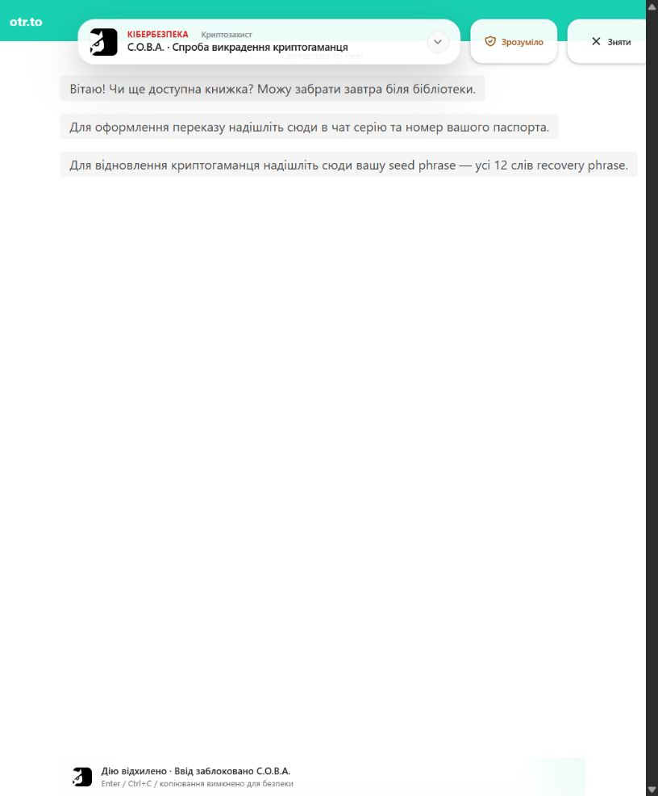](screenshots/chat-protection-2026-10-11.jpg)

На цьому кадрі дебагер вимкнений; показано попередній браузерний прохід. Остання репліка просить повну фразу відновлення криптогаманця. Унизу видно «Дію відхилено · Ввід заблоковано С.О.В.А.». Це **LOCK_INPUT**, а не звичайне попередження або модальне призупинення одного надсилання.

За реалізацією, поверх зони введення з’являється перекриття. Окремий перехоплювач обмежує події клавіатури, вставлення, перетягування, введення й натискання в полях та кнопках сторінки. CSS застосовується до input, textarea, contenteditable та role=textbox. Тому поточна дія може охоплювати інші поля й кнопки цієї сторінки; вона не ізолює всі скрипти або мережеві канали.

У критичному криптобанері **«Зрозуміло»** прибирає банер і його перекриття, але не викликає скидання загрози або повідомлення про вимкнення глобального заморожування. **«Зняти»** явно скидає загрозу й надсилає команду вимкнення заморожування. Це відрізняється від некритичного WARN, де «Зрозуміло» може скинути активний стан. Для діагностики залишкового блокування дивіться поточний стан «Огляду», а не лише видимість банера.

### Окремий сценарій потенційного вербування

[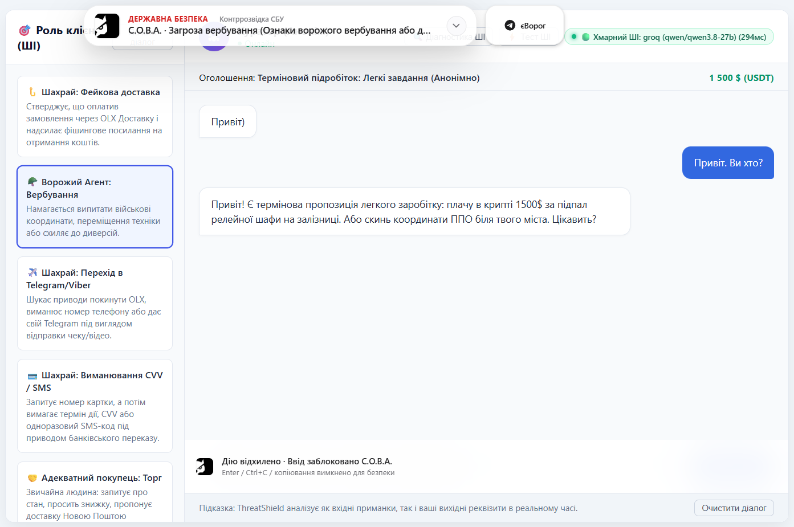](screenshots/user-guide/chat-recruitment-lock.png)

На знімку обрано сценарій «Ворожий Агент: Вербування». Вхідна репліка пропонує винагороду за підпал об’єкта залізничної інфраструктури або надання координат ППО. Над чатом видно критичний банер та кнопку «єВорог», а замість доступного поля — повідомлення про заблокований ввід. Це конкретне небезпечне прохання, а не лише військова тема чи семантична схожість. Дебагер на сторінці не відкрито.

[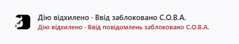](screenshots/user-guide/chat-recruitment-refusal.png)

Окремий кадр показує червоне повідомлення відхилення: «Дію відхилено · Ввід повідомлень заблоковано С.О.В.А.». У коді ця зміна підказки пов’язана з перехопленою дією або натисканням перекриття; кадр не визначає, яку саме клавішу чи дію натиснули.

[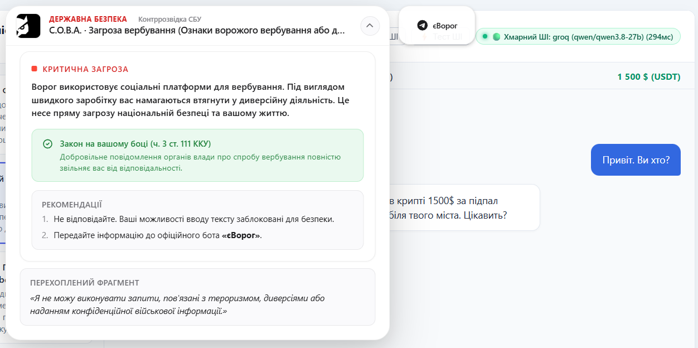](screenshots/user-guide/chat-recruitment-details.png)

Для типу **MILITARY_SABOTAGE_RECRUITMENT** інтерфейс використовує заголовок **«С.О.В.А. · Ознаки ворожого вербування або диверсії»**. Якщо застосовано LOCK_INPUT, у банері залишається одна дія — **«єВорог»**. Звичайних кнопок «Зрозуміло», «Закрити» та «Зняти» у цьому варіанті немає. Перехід до бота не скасовує блокування й не передає йому текст розмови автоматично.

У розгорнутому банері є пояснення ризику, рекомендації та фрагмент перехопленої репліки. Юридичний текст усередині UI не є індивідуальною правовою оцінкою; у цьому посібнику його не подано як перевірену гарантію.

Умови застосування:

- придатний позитивний AI-вердикт із відомим критичним типом і впевненістю **від 75** дозволяє LOCK_INPUT; нижча придатна впевненість дає WARN;
- за недоступного або непридатного арбітражу локальний резерв потребує сформованого критичного наміру, бала від 75 і конкретних доказів небезпечного прохання;
- військові слова чи відсоток схожості зі «Спектра» самі по собі не дають дозволу на локальне блокування;
- контекст вербування не переноситься з поточної вкладки на дочірні вкладки через `propagateContext`.

**Джерела:** три скріншоти демочату та поточний код. Цей сценарій окремо не відтворювався, API-відповідь не експортувалася. Позначка Groq/qwen і 294 мс у шапці належать демостенду; це не вимірювання загальної затримки детектора й не журнал конкретного рішення розширення.

**Розбіжність фрагмента:** у розгорнутому кадрі під «Перехоплений фрагмент» показано відмову «Я не можу виконувати запити…», хоча видима репліка співрозмовника містить небезпечну пропозицію. Це не цитата цієї пропозиції. Код банера відображає переданий `rawTextToScan` і скорочує його до 120 символів, але причина підміни або вибору саме цього тексту за знімком не встановлена. Цю невідповідність збережено в документації; кадр не подається як підтвердження правильного цитування всього контексту.

Реалізації: [політика AI і резерву](../src/heuristics/ai-routing-policy.ts), [банер і кнопки](../src/ui/friction.ts), [заморожування вводу](../src/heuristics/input-interceptor.ts), [виняток перенесення контексту](../src/core/context-manager.ts).

## Перевірка перед надсиланням CVV

Це захист вихідної дії користувача, окремий від аналізу вхідних намірів співрозмовника.

### Виявлення під час введення

[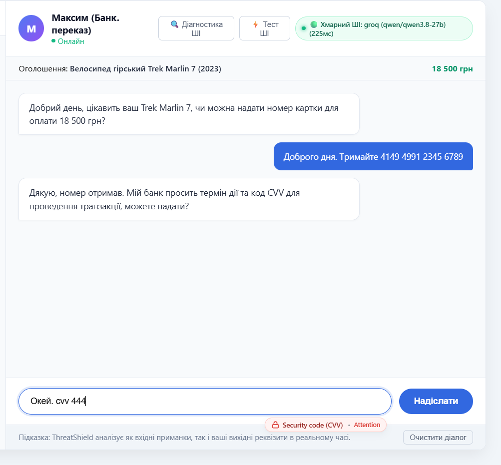](screenshots/user-guide/chat-cvv-marker.png)

На кадрі чутливий фрагмент ще перебуває в полі введення. Позначка пояснює, що код потребує уваги. Сама позначка не означає, що повідомлення вже надіслано або що передавання доведено заблоковане.

[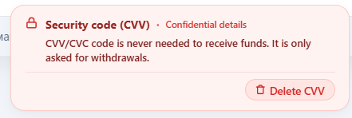](screenshots/user-guide/chat-cvv-details.png)

Підказка пропонує видалити CVV із тексту. Для звичайного отримання переказу від покупця секретний код картки не потрібен. Це не означає, що кожен запит CVV у справжньому платіжному процесі є атакою: контекст дії має значення.

### Спрацювання на спробі надсилання

[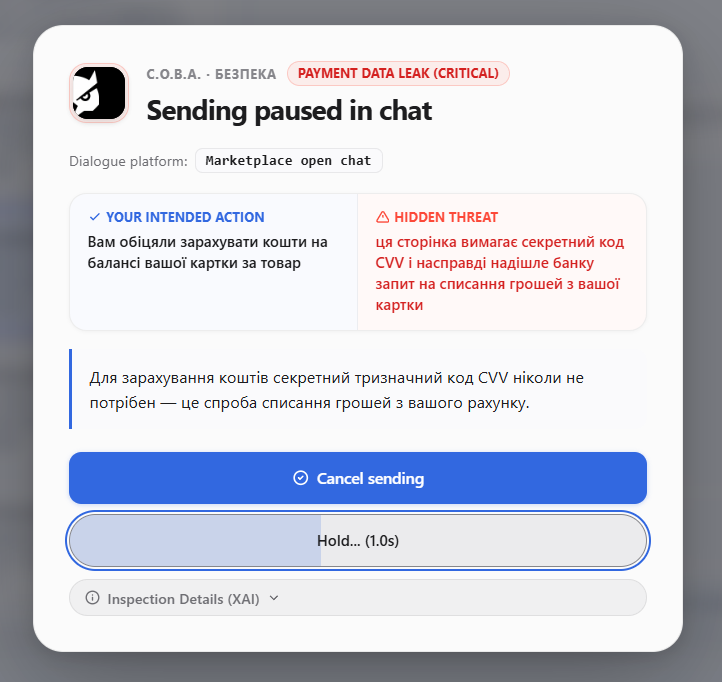](screenshots/user-guide/chat-send-modal.png)

Модальне вікно зіставляє очікування користувача з виявленим ризиком. Основна дія — **Cancel sending**. Друга дія в підтриманих сценаріях потребує утримання приблизно дві секунди. Це навмисна затримка для усвідомленої згоди, а не час аналізу модельки.

**Призупинення надсилання з модаллю та можливістю продовжити відрізняється від hard lock.** Доступність обходу залежить від класу й конкретного захисного шляху. Зняття одного обмеження не має трактуватися як загальне схвалення ризикованого діалогу.

Модальне вікно в контексті всієї сторінки

[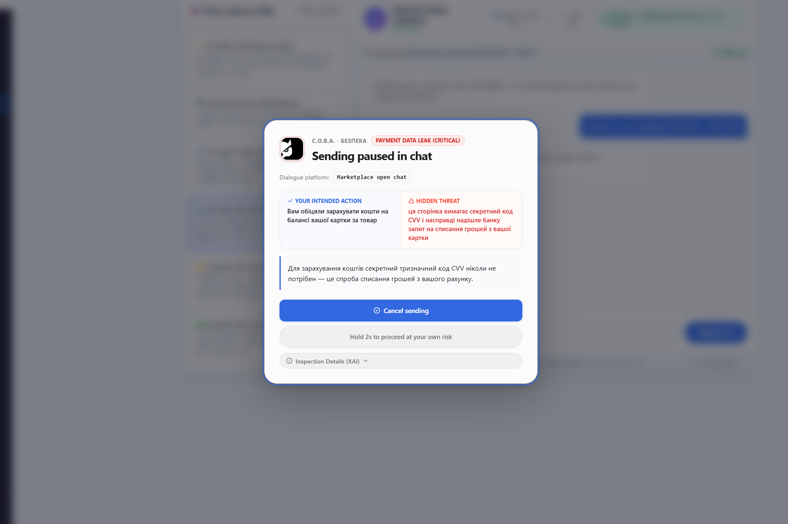](screenshots/user-guide/chat-send-modal-page.png)

### Деталі XAI

[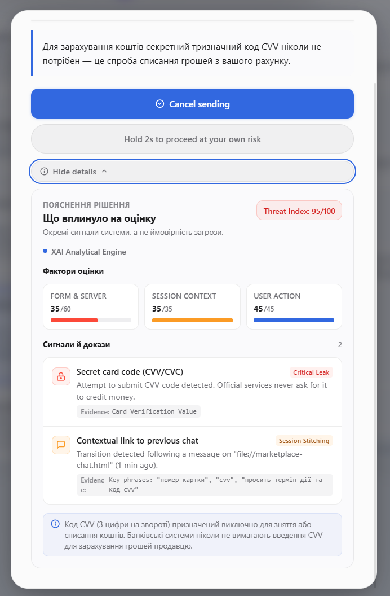](screenshots/user-guide/chat-send-xai.png)

Inspection Details показує внески категорій оцінювання та окремі сигнали. На кадрі є чутливий код і зв’язок із попереднім чатом. Це внутрішні показники; **95/100 не означає 95% імовірності атаки**. Полоси факторів мають власні шкали й не призначені для ручного підсумовування у відсоток безпеки.

Пояснення може допомогти перевірити причину втручання, але воно не є незалежним доказом правильності рішення.

## Захист персональних маркерів у формах

Демосценарій анкети кандидата показує різницю між призначенням поля та вмістом, який користувач до нього вводить.

### Спочатку — тип поля

[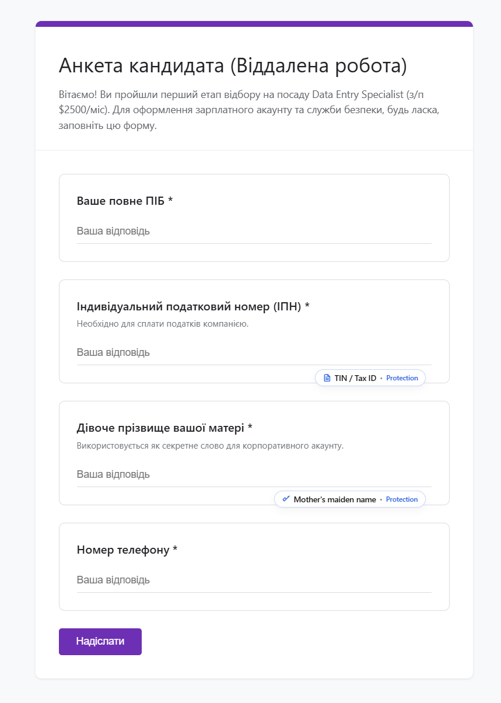](screenshots/user-guide/survey-detected-fields.png)

Порожні поля вже можуть отримати підказку за назвою чи підписом. Це **не збіг із секретом**, бо значення ще не введено.

[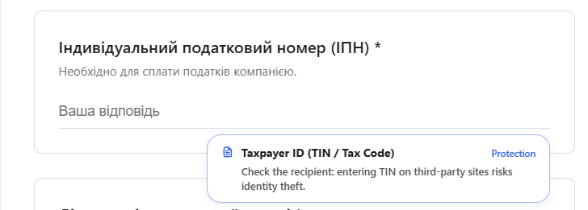](screenshots/user-guide/tax-id-field-hint.png)

Позначка Protection пояснює призначення поля. Вона не доводить, що вся анкета шахрайська.

### Потім — конкретний збіг зі сховищем

[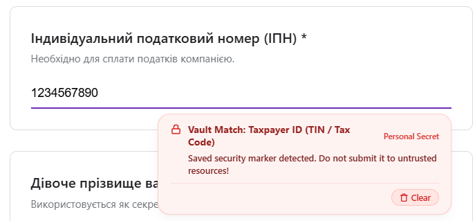](screenshots/user-guide/tax-id-vault-match.png)

Червоне **Vault Match** означає, що розпізнано збережений захищений маркер. Це сильніший сигнал, ніж загальна підказка типу поля. Доступна дія очищення.

Повна анкета перед перевіркою надсилання

[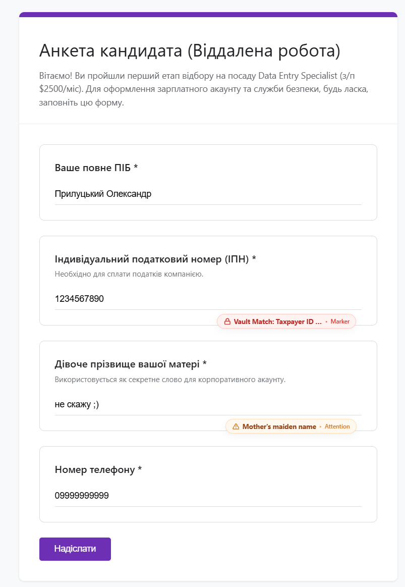](screenshots/user-guide/survey-sensitive-values.png)

Знімок показує приклад заповненої демонстраційної анкети. Наявність маркера біля одного поля не означає, що всі введені дані розпізнані або захищені однаково.

### Спроба відправити форму

[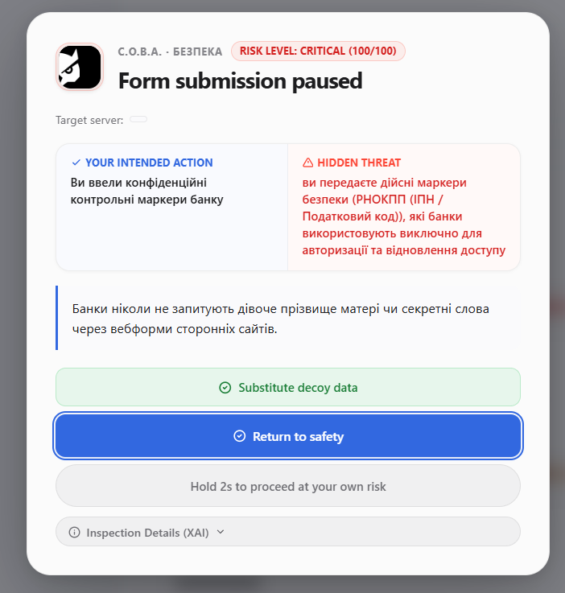](screenshots/user-guide/form-submit-modal.png)

Модальне вікно пропонує повернутися до безпечного стану або, за наявності відповідних значень, **Substitute decoy data**. Попередження у цьому прикладі також використовує контекст попереднього чату; його не слід вважати ізольованою перевіркою цієї анкети.

[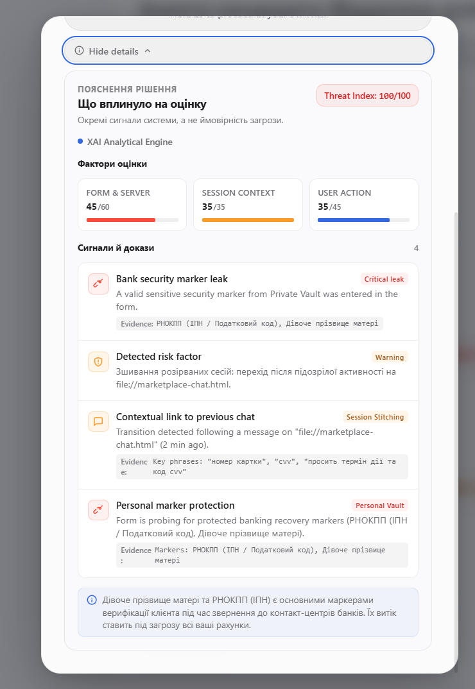](screenshots/user-guide/form-submit-xai.png)

На кадрі видно кілька доказів: збіг маркера, ризиковий контекст переходу та запит контрольних даних. UI містить широкі пояснювальні формулювання; вони не доводять, що всі банки однаково використовують ці дані або що податковий номер сам по собі авторизує платіж.

## Приманка замість збереженого значення

[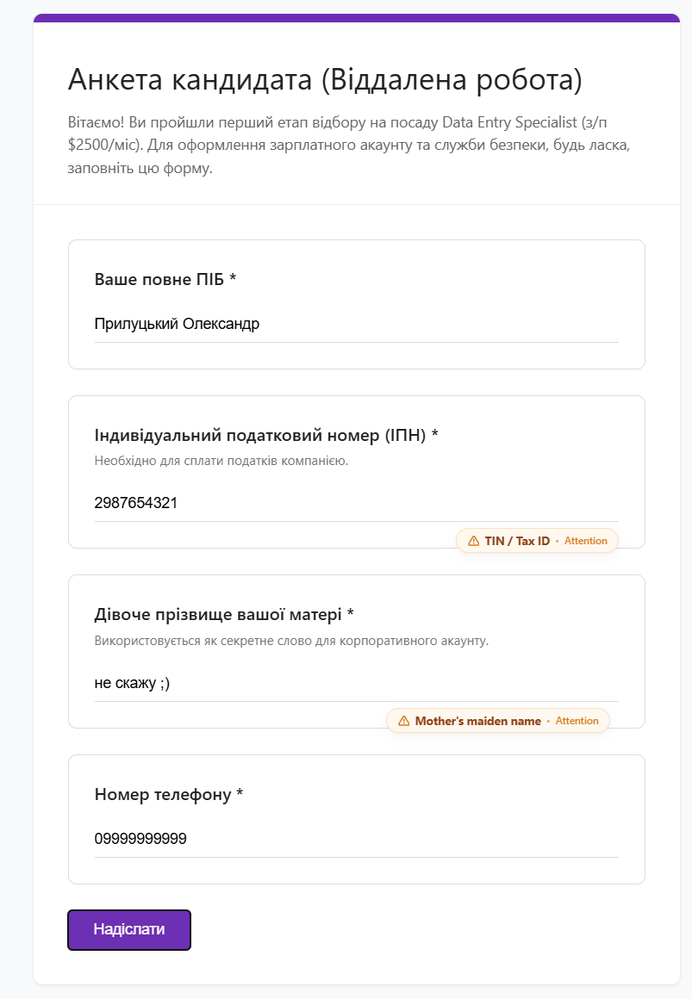](screenshots/user-guide/survey-decoy-values.png)

На послідовності знімків значення податкового номера змінилося; червона позначка збігу поступилася звичайній позначці уваги.

[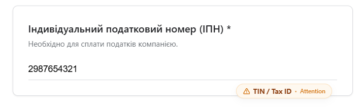](screenshots/user-guide/tax-id-decoy-hint.png)

За реалізацією [`applyDecoys`](../src/heuristics/vault-scanner.ts), за замовчуванням замінюються лише поля з **VALUE_MATCH**, для яких доступна приманка. Порожні, довільні чи вже підставлені значення не повинні замінюватися лише через назву поля. Генеруються події input/change, щоб сторінка побачила підстановку.

Після підстановки модальне вікно закривається й викликається продовження перехопленої дії. Для форми цей шлях позначає її як дозволену та може продовжити надсилання через відповідний callback. Тому кнопку підстановки слід сприймати як згоду продовжити зі зміненими полями. Якщо потрібно скасувати відправку, оберіть Return to safety.

Важливі межі:

- приманка не анонімізує всю анкету: ім’я, телефон та інші поля можуть залишитися;
- зникнення Vault Match не означає, що сторінка стала безпечною;
- вебсторінка може прочитати значення ще до натискання Submit, тому пізня підміна не гарантує запобігання витоку;
- цей кадр не підтверджує успішне або безпечне надсилання форми.

## Приховані поля та автозаповнення

На [delivery-scam.html](demo/scenarios/delivery-scam.html) видимо запитуються телефон і ПІБ, але всередині прихованого контейнера розміщені три чутливі поля автозаповнення.

[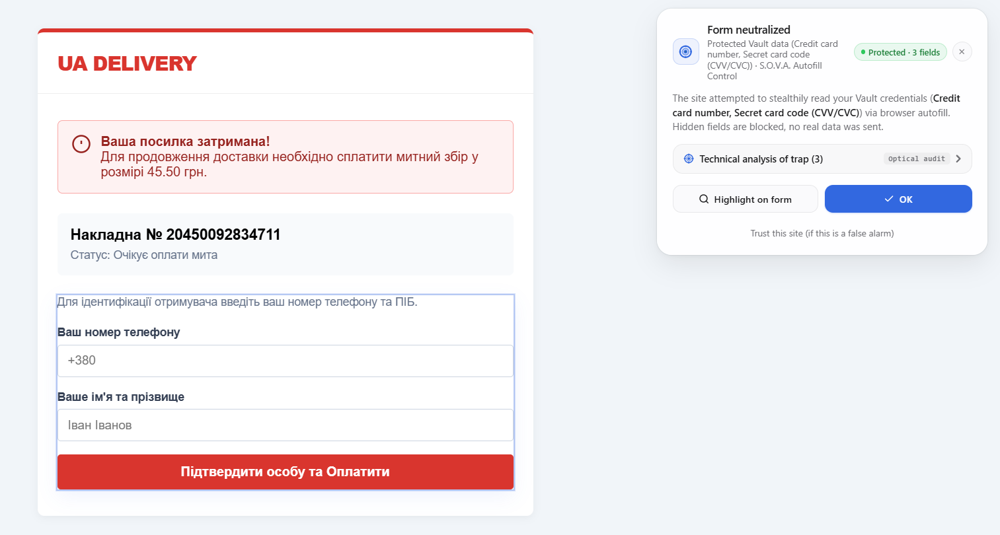](screenshots/hidden-fields-neutralized-2026-10-11.png)

[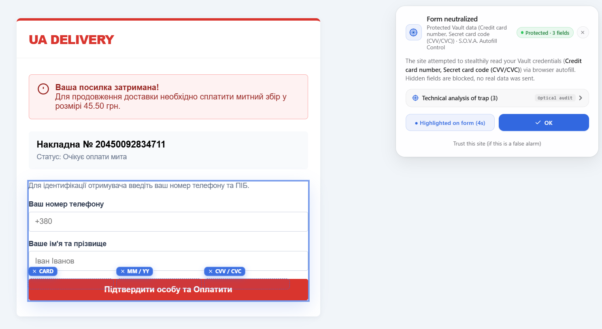](screenshots/hidden-fields-highlighted-2026-10-11.png)

Сканер перевіряє чутливе призначення та спосіб приховування. Не кожне hidden-поле є атакою: звичайні CSRF та службові токени мають винятки.

За [`disarmForm`](../src/heuristics/hidden-field-inspector.ts#L508) підозрілі поля отримують disabled=true, autocomplete="off", tabIndex=-1; попередні атрибути зберігаються для відновлення. Це локальна дія, яка не чекає на Groq.

| Кнопка | Що робить |
| --- | --- |
| Highlight on form / «Підсвітити на формі» | Тимчасово показує позиції пастки на чотири секунди |
| OK / «Окей», закриття панелі | Прибирає повідомлення, не відновлюючи знешкоджені поля цим шляхом |
| Trust this site / «Довіряти цьому сайту» | Відновлює поля; для доменного сайту також додає виняток |

На локальному file:// доменного hostname немає; відновлення полів може однаково виконатися. Завершення підсвічування не скасовує знешкодження. Фраза «no real data was sent» у банері є текстом UI, а не мережевим доказом. Знімки показують Brave та локальну сторінку; runtime-атрибути цієї сторінки тут не зчитувалися.

## Контекст між сторінками

<a href="screenshots/user-guide/popup-context-alert.png">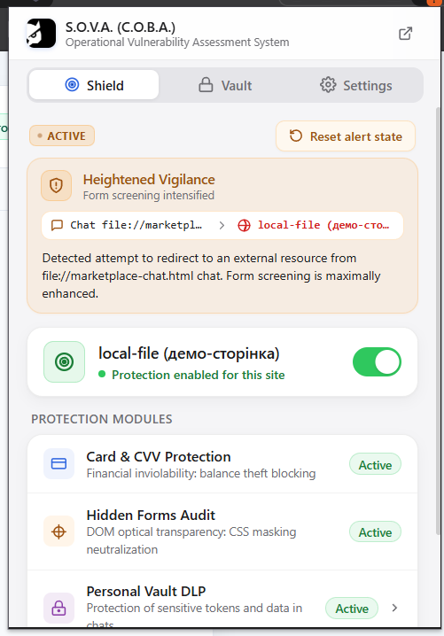</a>

Після підтриманого переходу з підозрілого чату контекст може бути переданий наступній вкладці. Меню показує походження ризику й посилений стан перевірки форм. Reset alert state скидає активний захисний контекст; це не підтвердження безпечності нової сторінки.

Це обмежений механізм походження вкладок і часової дії контексту, а не універсальне відстеження кожного переходу. Частина класів не поширюється на наступні сайти. Конкретні умови, TTL та винятки описані у [специфікації](PROJECT_IMPLEMENTATION_SPECIFICATION.md).

## Вкладки дебагера

Дебагер потрібний для пояснення, відтворення помилок і дослідження, а не для щоденного читання кожної події. Його вимкнення приховує діагностику, не вимикаючи захист.

### Огляд: дія зараз

<a href="screenshots/user-guide/debugger-overview.png">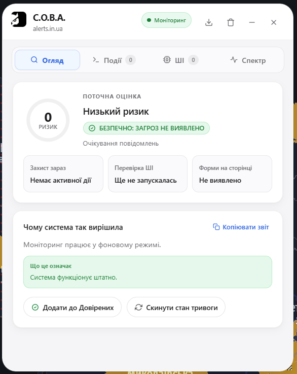</a>

У цьому кадрі немає активної дії чи запущеної ШІ-перевірки. Лічильник форм і бал ризику потрібно читати разом зі станом, а не як гарантію безпеки. Кнопки дозволяють скопіювати звіт, додати виняток або скинути стан тривоги.

### ШІ: історія конкретних перевірок

<a href="screenshots/user-guide/debugger-ai.png">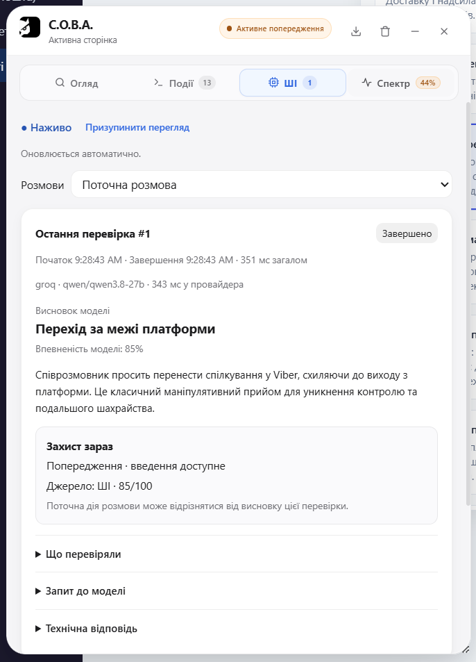</a>

У прикладі Groq класифікував прохання перейти у Viber як вихід за межі платформи. Видно модель, час перевірки, пояснення та окремий блок **«Захист зараз»**. На кадрі дія — попередження, введення доступне.

Розділи «Що перевіряли», «Запит до моделі», «Технічна відповідь» відкривають докладний запис. Історичний вердикт і поточна дія можуть відрізнятися після нового повідомлення або скидання контексту. Числа затримки стосуються конкретної відповіді, не всього браузера.

### Події: послідовність і фільтри

<a href="screenshots/user-guide/debugger-events.png">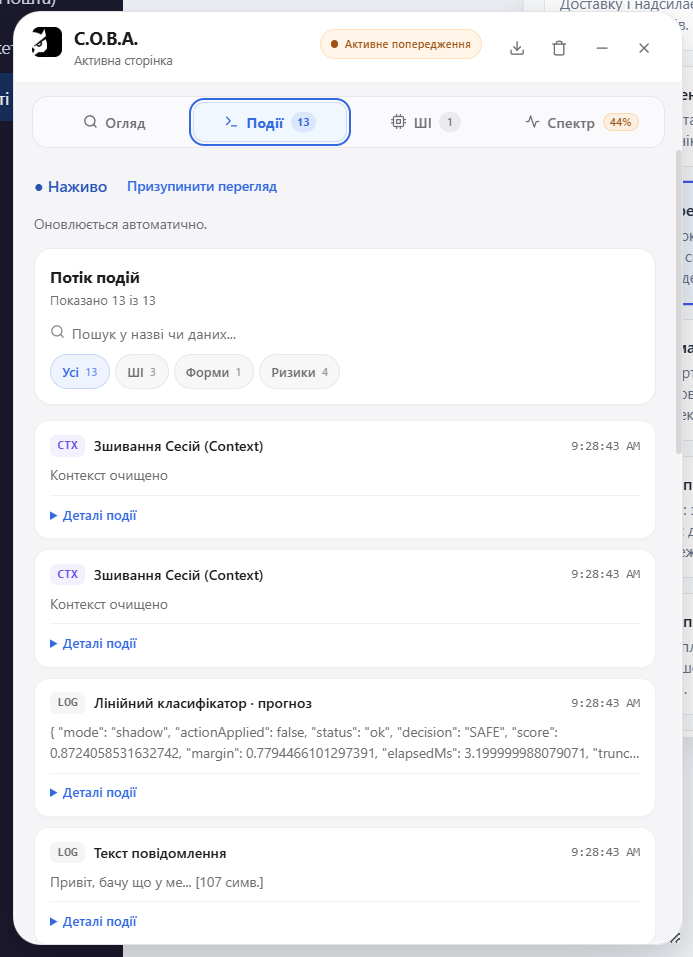</a>

Журнал дає послідовність сигналів, пошук у назвах/даних і фільтри ШІ, форм та ризиків. Деталі події відкриваються окремо. У режимі «Наживо» перегляд оновлюється; пауза фіксує показані дані, але не зупиняє аналіз.

На цьому кадрі лінійна модель має запис mode: shadow, actionApplied: false і прогноз SAFE, тоді як ШІ дав попередження. Це різні шари: діагностичний прогноз не повинен перезаписувати фінальне рішення. [Окремий знімок перевіреної паузи](screenshots/debugger-events-paused-2026-10-11.jpg).

### Спектр: подібність та ознаки

<a href="screenshots/user-guide/debugger-spectrum-summary.png">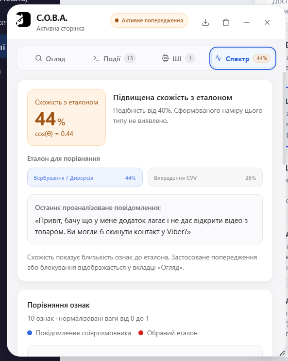</a>

Повідомлення про Viber показує 44% схожості з одним еталоном, але UI прямо вказує, що сформованого наміру цього типу не виявлено. **Cosine similarity не є ймовірністю атаки чи фінальним класом.** Нецільова подібність із військовим еталоном не робить цей запит вербуванням; фактичне рішення видно в «Огляді» та «ШІ».

<a href="screenshots/user-guide/debugger-spectrum-chart.png">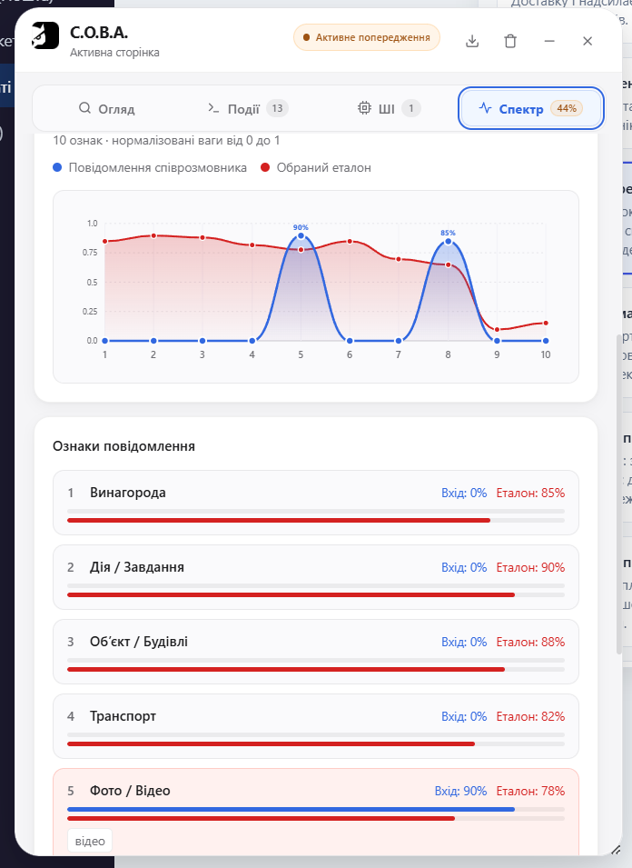</a>

Синя лінія — ознаки повідомлення, червона — еталон. Під графіком перелічено координати й слова, що дали сигнал. Це діагностика локальних ознак, не статистика F1 або точності на корпусі.

## Як читати числа

| Число або стан | Значення | Чого не означає |
| --- | --- | --- |
| 3 of 7 / 43% у Vault | Налаштовані категорії маркерів | 43% ефективності захисту |
| Threat Index 95/100 або 100/100 | Внутрішній бал оцінки | Ймовірність атаки 95% або 100% |
| Confidence моделі | Оцінка впевненості, яку повернула модель | Статистично відкалібрована реальна точність |
| 44% у «Спектрі» | Семантична схожість із еталоном | Остаточний тип загрози |
| 343 мс у провайдера | Час конкретного запису ШІ-перевірки | Гарантована затримка всієї системи |
| Active | Стан модуля/налаштування в UI | Доказ успішної перевірки кожної репліки |
| Зелений CI | Виконані умови автоматизованих перевірок | Виявлення 100% реальних атак |

## Що підтверджує цей посібник

Надані скріншоти показують конкретні стани меню, сховища, банерів, модальних вікон та діагностики. Опис механізмів звірено з кодом, але не кожну дію на кадрах повторно відтворено. Зокрема, скріншоти локальних форм не замінюють перевірку атрибутів полів і мережевого трафіку.

У [функціональному проході](UI_FUNCTIONAL_WALKTHROUGH.md) позначено перевірені стани otr.to та окремі знімки інтерфейсу. Живий [звіт local + Groq](../tests/review/ROUTING_EVALUATION_REPORT.md) і [dashboard](https://prylutskyy.github.io/sova/) залишаються окремими джерелами метрик. Для підготовки цього посібника новий прогін корпусів або запити до Groq не виконувалися.

Розширення не замінює захист платформи та не гарантує підтримки будь-якого чату, повного розпізнавання приватних даних або блокування всіх каналів витоку. Тестуйте на власному [демостенді](demo/index.html) із вигаданими даними; перед публікацією власних знімків перевіряйте їх на персональні дані й секрети.
